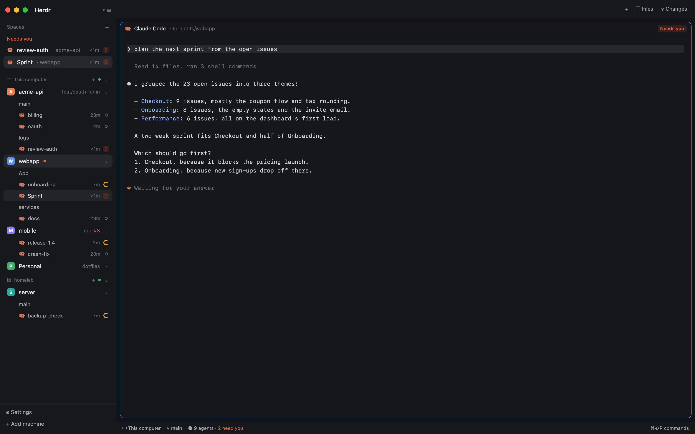

# One sidebar

Herdr's main layout with spaces, tabs and agents in one sidebar list. Each space lists its tabs underneath. A tab with an agent in it shows that agent's icon, time and status inline, so the separate Agents list and the tab pills in the top bar are gone. Agents that need you, and pinned ones, sit at the top of the sidebar.

The preview is a mockup of the real window with made-up space, tab and agent names.

## What you see

- **Sidebar (268px, left, `chrome` background).** The same frame as Herdr main: the brand bar (46px) on top, then the sidebar list, then the footer (69px, Settings and Add machine).
- **Top of the list, only when something is there:**
  - **Pinned:** a dim 11.5px "Pinned" header and one 28px row per pinned agent.
  - **Needs you:** an 11.5px "Needs you" header in the `blocked` color and one 28px row per agent that is blocked or done. Blocked agents come first, then the most recently changed.
  - Each row: the program icon (14px), the tab's name in `foreground`, then `· <space name>` in `dim`.
  - A 1px `border` line separates this part from the spaces.
- **Spaces, grouped by machine** as in Herdr main. Each space row (30px) shows:
  - the colored avatar, the name, and git repo, branch and ahead/behind on the right;
  - a 6px dot after the name when an agent in the space is blocked or done (`blocked` or `done` color);
  - a chevron (11px) at the far right that folds or unfolds the space's tabs.
- **Tab rows under each space** (26px, 35px left indent, 12px text):
  - **No agent:** the tab's name in `muted`, or `foreground` with a `hover` background when it is the active tab of the active space.
  - **One agent:** the program icon, the tab's name, the time since the agent's state last changed (`<1m`, `5m`, `2h`, `3d`, 11px `dim`), and a status mark at the end.
  - **Several agents:** a plain tab row, then one 24px row per agent (53px indent) named by its terminal title or program.
- **Top bar (42px):** no tab pills. A drag area on the left; on the right `+` (the new-menu popup), Files and Changes.
- **Work area and status bar:** exactly as in Herdr main.

## How it behaves

- **Agent status marks:**
  - working: a 12px `working`-colored spinner (900ms turn);
  - blocked: a 14px rounded square with a bold `!` in `blocked` on a 15%-alpha `blocked` fill;
  - done: a 7px `done` dot;
  - idle: a 7px ring in `idle`.
- **Clicks:**
  - a plain tab row selects its space, then the tab;
  - an agent row focuses the agent's pane (`pane.focus`);
  - double-click or right-click on any tab or agent row asks for a new name and renames the tab (`tab.rename`). The tab name is the agent's name.
- **Hover** on an agent row swaps the time for a pin button: `terminal.pin` with `pinned` toggled.
- **The chevron** folds a space's tabs. Folded spaces are remembered in the mod's localStorage (`spaces.folded`).
- **`agent.next` / `agent.prev`** follow the sidebar order: pinned agents first, then agents in space and tab order (`setAgentOrder`).
- **Narrow sidebar** (under 160px): the numbered space rail from Herdr main, without tabs.
- **Everything else** is Herdr main's spaces list: drag to reorder within a machine, right-click a space for its menu, worktree spaces nested under their repo, machine headers with fold, add and reconnect.

## Built from

- **`layouts/one-sidebar.json`:** Herdr main 0.1.14 with three changes:
  - the `spaces` block uses `{ "mod": "one-sidebar" }`;
  - the `agents` block keeps the shipped `agents` mod but has `"hidden": true`;
  - the `tabs` block uses `{ "mod": "one-sidebar-tabs" }`.
- **`mods/one-sidebar`:** a clone of the shipped `spaces` mod (0.1.14).
  - Reads `agents()` once per render, maps agents by tab, and draws tab rows after each space row.
  - Adds `track()`, which keeps each agent's last state and when it changed in localStorage `agents.changed`; done and idle count as one state, and entries older than 30 days are dropped.
  - Uses `run` with `space.select`, `tab.select`, `tab.rename`, `pane.focus`, `terminal.pin`, `space.move` and `space.new`, plus `setAgentOrder`.
  - Runs `git` (via `exec`) for repo and branch and `hc machine ls/rm/add` for machine headers, both inherited from `spaces`.
  - Uses the shipped icons in `mods/workspace-chrome/`: plus, chevron-down/right, branch, pin, pin-off, spinner, monitor, server.
- **`mods/one-sidebar-tabs`:** a clone of the shipped `tabs` mod (0.1.14) with the tab pill list replaced by an empty flex spacer.
  - It keeps the per-space Files/Changes panel memory, scroll-wheel `tab.prev`/`tab.next` over the bar, and the Windows window buttons (its own `win-*.svg`).

## Watch out

- **Shipped mods are read-only and replaced on every start.** Clone and rename them; never edit `spaces` or `tabs` in place.
- **The draw function now returns arrays** (a space row plus its tab rows), so both places that map rows must use `flatMap`.
- **Space row clicks happen on mouse-up, after a mouse-down drag check.** The chevron has to stop propagation on mouse-down, mouse-up and click, or folding also selects the space.
- **Time labels start at `<1m`** for every agent the first time the mod runs, because it only knows changes it has seen.
- **Sub-agents are not drawn as a tree under their parent.** A sub-agent with its own pane shows up as one more agent in its tab.
- **The Agents block is hidden, not removed.** `layout.show {id: "agents"}` brings the old list back next to the new one.
- **`herdr-app shot` can return the previous frame.** Take two shots when checking a change.

## Done when

- Every space lists its tabs, and a tab running Claude Code (or any agent) shows the program icon, a time and a status mark in the same row.
- No Agents list and no tab pills are visible; `+`, Files and Changes still work.
- When an agent is blocked or finishes, it appears under "Needs you" at the top and its space shows a dot. Opening it moves it out once it turns idle.
- Double-clicking an agent row and typing a name renames its tab, and the row shows the new name.
- The chevron folds a space's tabs, and the fold survives a restart.
- `herdr-app status` shows no errors with `layout.switch {name: "one-sidebar"}`.
